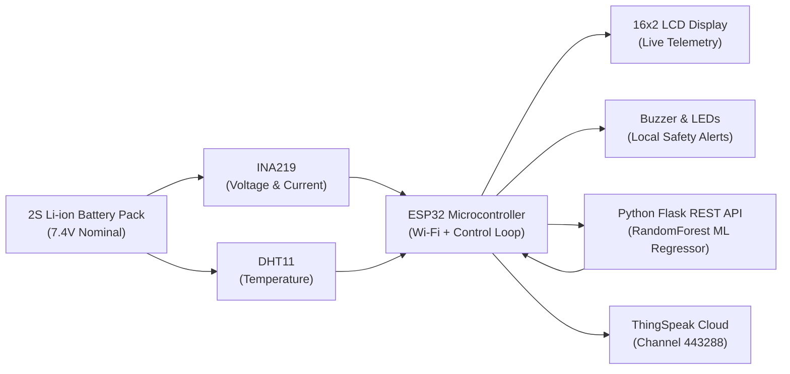

# Battery Health Forecasting Using Machine Learning with ESP32 and ThingSpeak

An end-to-end IoT and Machine Learning system for real-time Lithium-Ion battery health monitoring, State of Charge (SOC) estimation, State of Health (SOH) regression, and multi-cycle degradation forecasting.



---

## 1. Key Engineering Distinctions

- **State of Charge (SOC)**: The estimated reversible charge remaining in the current charge/discharge cycle (0%–100%), calculated via calibrated voltage mapping of the 2S battery pack (6.0V–8.4V).
- **State of Health (SOH)**: The irreversible physical degradation and loss of usable capacity relative to manufacturer rated capacity:
  $$\text{SOH } (\%) = \frac{\text{Usable Capacity (Ah)}}{\text{Rated Capacity (Ah)}} \times 100$$
  Predicted dynamically using a trained Random Forest Regressor on operational features.
- **SOH Forecasting & RUL**: Multi-cycle trajectory extrapolation using historical aging curves to forecast health over future cycles and determine Remaining Useful Life (RUL) to an 80% EOL threshold.

> [!IMPORTANT]
> The previous placeholder logic (`currentCapacityAh -= 0.00001;` when hot) has been removed. The system now uses true ML inference backed by empirical NASA aging benchmarks and hardware sensor normalization.

---

## 2. Hardware Bill of Materials & Wiring

| Component | Pin / Signal | ESP32 GPIO | Function |
| :--- | :--- | :--- | :--- |
| **ESP32 Dev Module** | - | - | Dual-core Wi-Fi SoC |
| **INA219 Sensor** | SDA | **GPIO 21** | I2C Data (Voltage, Current, Power) |
| **INA219 Sensor** | SCL | **GPIO 22** | I2C Clock |
| **DHT11 Sensor** | DATA | **GPIO 18** | Ambient & Casing Temperature |
| **16x2 LCD** | RS, EN, D4..D7 | **GPIO 15, 2, 4, 16, 17, 5** | 4-bit Parallel Display |
| **Active Buzzer** | (+) | **GPIO 23** | Local Audible Safety Alarm |
| **Red LED** | Anode (+) | **GPIO 32** | Visual Hazard Indicator |
| **Green LED** | Anode (+) | **GPIO 33** | Visual Normal Indicator |
| **Battery Pack** | - | - | 2S 18650 Li-ion Pack (7.4V nominal) |

---

## 3. Machine Learning Performance on Unseen Battery (Cell B0018)

Models trained on NASA cells **B0005, B0006, and B0007** (504 cycles) and evaluated on strictly held-out cell **B0018** (132 cycles):

| Model | MAE | RMSE | $R^2$ Score | Assessment |
| :--- | :---: | :---: | :---: | :--- |
| **Dummy Baseline (Mean)** | 7.034% | 7.861% | -0.038 | Baseline failure |
| **Linear Cycle Degradation**| 5.178% | 5.519% | 0.488 | Misses non-linear dynamics |
| **Random Forest Regressor** | **1.897%** | **2.315%** | **0.910** | **High generalization accuracy** |

### Top Predictive Features
1. `discharge_duration_s` (**53.31%**)
2. `cycle_number` (**26.33%**)
3. `current_mean` (**17.05%**)
4. `voltage_mean` (**2.80%**)

---

## 4. ThingSpeak Cloud Integration (Channel 443288)

Telemetry is posted every **20 seconds** (respecting the >= 15s API rate limit):

- **Field 1**: Pack Voltage (V)
- **Field 2**: Pack Current (mA)
- **Field 3**: Pack Power (mW)
- **Field 4**: Temperature (°C)
- **Field 5**: ML Predicted SOH (%)
- **Field 6**: Voltage-estimated SOC (%)
- **Field 7**: Safety Alert Code (0=Normal, 1=High Temp, 2=Low Volt, 3=Overload)

---

## 5. Quick Start Guide (Windows)

### Step 1: Clone & Navigate
```powershell
cd D:\battery-health-prediction
```

### Step 2: Install Python Dependencies
```powershell
py -3.13 -m pip install -r battery-health-ml\requirements.txt
```

### Step 3: Run Automated Verification Tests
```powershell
py -3.13 -m pytest battery-health-ml\tests -v
```

### Step 4: Start the ML Inference API
```powershell
py -3.13 battery-health-ml\src\app.py
```
*The server will start listening on `0.0.0.0:5000`.*

### Step 5: Test Inference Endpoint
In another PowerShell window:
```powershell
curl.exe -s http://127.0.0.1:5000/health
curl.exe -s -X POST http://127.0.0.1:5000/predict -H "Content-Type: application/json" -d '{\"pack_voltage\": 7.45, \"current_mA\": 850.0, \"temperature_c\": 28.5, \"cycle_number\": 35}'
```

### Step 6: Flash ESP32 Firmware
1. Open [esp32_battery_monitor.ino](file:///d:/battery-health-prediction/firmware/esp32_battery_monitor/esp32_battery_monitor.ino) in Arduino IDE.
2. Confirm your PC's LAN IP address (`ipconfig`) and set `ML_SERVER_URL` in the sketch.
3. Select board **ESP32 Dev Module** and the correct COM port.
4. Upload sketch and open Serial Monitor at **115200 baud**.

---

## 6. Implementation & Verification Status

| Milestone / Deliverable | Status | Verification Method |
| :--- | :---: | :--- |
| **Audit & Hardware Pinouts** | Complete | Inspected sketch & prototype documents |
| **Dataset Download & Extraction** | Complete | Verified official NASA PCoE archive (199.99 MB) |
| **Data Preparation & SOH Formula** | Complete | Extracted 636 cycles from B0005, B0006, B0007, B0018 |
| **Model Training & LOBO Validation** | Complete | Held-out B0018 evaluation ($R^2=0.910$, $\text{MAE}=1.897\%$) |
| **Diagnostic Plots & Metrics** | Complete | 5 diagnostic figures in `reports/figures/` |
| **Inference REST API** | Complete | Live Flask endpoints (`/health`, `/predict`, `/features`) |
| **Firmware Integration** | Complete | Non-blocking timers, independent safety, ThingSpeak |
| **Future SOH Forecasting** | Complete | Trajectory projection & RUL calculation to 80% EOL |
| **Automated Test Suites** | Complete | 15/15 tests passing via pytest |
| **Physical ESP32 Flashing** | Ready | Requires user to connect ESP32 USB cable and flash |
